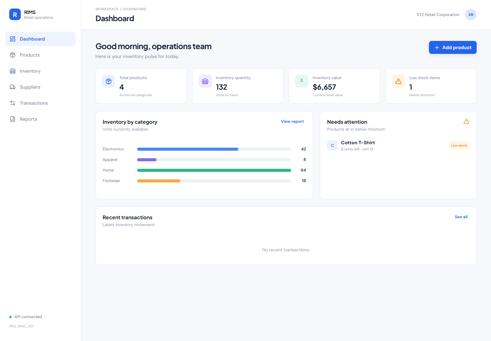
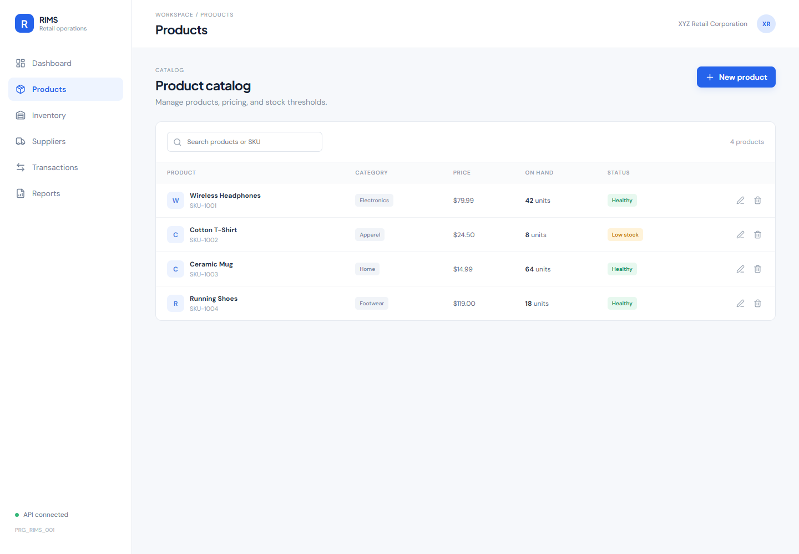

# RIMS - Retail Inventory Management System

RIMS is a compact, full-stack inventory workspace for XYZ Retail Corporation. It gives retail operations teams a single place to review stock health, manage a product catalog, maintain suppliers, record stock movement, and export inventory summaries.

**Project code:** `PRG_RIMS_001`  
**Domain:** Retail Inventory Management  
**Status:** Functional implementation with PostgreSQL configuration and H2 development fallback.

## Objectives and problem statement

Manual spreadsheets make stock visibility slow, inconsistent, and difficult to audit. RIMS addresses this with persistent product and supplier records, threshold-based low-stock identification, transaction history, and a dashboard backed by REST APIs.

## Features

| Area | Implemented capability |
|---|---|
| Dashboard | KPIs, category chart, low-stock attention list, recent movement |
| Products | Search, create, edit, delete, price and threshold management |
| Inventory | Stock coverage, minimum levels, stock movement capture |
| Suppliers | Directory with create, edit, delete, and contact details |
| Transactions | Stock-in/stock-out history with timestamps and validation |
| Reports | Inventory summary and CSV export |

## Technology stack

| Layer | Technology |
|---|---|
| Frontend | React, Vite, JavaScript, Axios, Lucide React, responsive CSS |
| Backend | Java 17, Spring Boot 3.3, Spring Web, Spring Data JPA |
| Database | PostgreSQL 16 in Docker; H2 file database for local verification |
| Reporting | CSV export and ReportLab-generated PDF project report |

## Screenshots

| Dashboard | Product catalog |
|---|---|
|  |  |

## Architecture

See [docs/architecture.md](docs/architecture.md) for Mermaid flow and ER diagrams.

## Project structure

```text
.
├── frontend/                 # React + Vite application
├── backend/                  # Spring Boot Maven application
├── docs/                     # Architecture diagrams
├── screenshots/              # Genuine UI captures
├── output/pdf/               # Academic project report
├── .env.example              # Configuration template
├── docker-compose.yml        # PostgreSQL + backend
└── README.md
```

## Prerequisites

- Node.js 18+ and npm
- Java 17+
- Maven 3.9+
- PostgreSQL 14+ or Docker Desktop

## Run locally

```powershell
cd backend
mvn spring-boot:run
```

The default development profile uses a file-backed H2 database at `backend/data/rims`, so changes persist across restarts. Sample products and suppliers are inserted on first startup.

```powershell
cd frontend
npm install
npm run dev
```

Open `http://localhost:5173`.

For PostgreSQL and the containerized backend:

```powershell
docker compose up --build
```

The backend container uses `SPRING_DATASOURCE_URL`, `SPRING_DATASOURCE_USERNAME`, and `SPRING_DATASOURCE_PASSWORD`. See `.env.example`.

## API endpoints

| Method | Endpoint | Purpose |
|---|---|---|
| GET/POST | `/api/products` | List or create products |
| PUT/DELETE | `/api/products/{id}` | Update or remove a product |
| GET/POST | `/api/suppliers` | List or create suppliers |
| PUT/DELETE | `/api/suppliers/{id}` | Update or remove a supplier |
| GET/POST | `/api/transactions` | Read or record stock movement |
| GET | `/api/dashboard` | KPI and recent transaction payload |
| GET | `/api/reports/inventory.csv` | CSV inventory export |

## Usage

Use the sidebar to move between modules. Add products and suppliers with the primary action buttons. Use Inventory to record stock in/out; stock-out requests larger than available stock are rejected. Low-stock status is calculated as `quantity <= minStock`.

## Testing and verification

The implementation includes production build configuration, Maven backend configuration, seed data, persistent H2 development mode, PostgreSQL Docker configuration, CSV generation, and a ReportLab PDF generator. Actual commands run for this workspace are reported in the final handoff; PostgreSQL runtime verification depends on Docker or a local PostgreSQL service being available.

## Limitations and future enhancements

The current scope intentionally excludes authentication/roles, purchase orders, barcode scanning, multi-location warehouses, and supplier-to-product foreign-key assignments. Future work can add Spring Security, role-based approvals, replenishment suggestions, and richer analytics.

## License

Academic / demonstration project for XYZ Retail Corporation.
